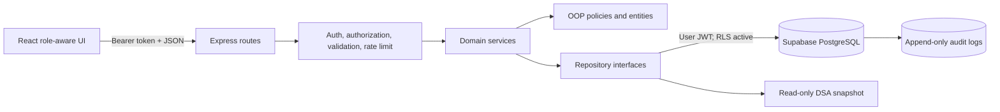
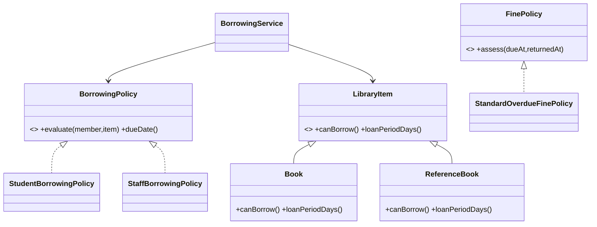

# Final OOP and DSA evidence

This document is the assessment map for the Smart Library Borrowing and Management System. It links each academic claim to a real feature, its implementation, and executable evidence. PostgreSQL remains authoritative; the educational data structures are read-only projections.

## System boundary

Routes translate HTTP. Services coordinate use cases. Domain classes enforce policy and state transitions. Repositories isolate persistence. The browser uses Supabase only for authentication and never receives a service-role credential.

## OOP class relationships

| Principle | Meaningful implementation | Source | Executable evidence |
|---|---|---|---|
| Encapsulation | Member, loan, and item state changes through validated methods and private fields | `server/src/domain/member.ts`, `loan.ts`, `library-item.ts` | `server/src/domain/domain.test.ts` |
| Abstraction | Borrowing and fine policies expose stable contracts independently of orchestration | `server/src/domain/borrowing-policy.ts`, `fine-policy.ts` | `domain.test.ts`, `fine-policy.test.ts` |
| Inheritance | Borrowable and reference books genuinely specialize a library item | `server/src/domain/library-item.ts` | `domain.test.ts` |
| Polymorphism | Borrowing service invokes the selected policy contract; subtype behavior changes without condition-heavy callers | `server/src/services/borrowing.service.ts` | `domain.test.ts`, `circulation.service.test.ts` |
| Repository abstraction | Services depend on repository interfaces and are unit-tested with in-memory doubles | `server/src/repositories/*.repository.ts`, `server/src/services/*.service.ts` | all `*.service.test.ts` files |

## DSA feature and complexity evidence

Let `n` be the number of projected records, `V` books, `E` related-book edges, and `k` a chain length.

| Structure / algorithm | Library feature | Time | Space | Source and tests |
|---|---|---:|---:|---|
| Array filtering | Catalog criteria pipeline | `O(n)` | `O(n)` results | `dsa/algorithms/array-algorithms.ts`, `advanced-structures.test.ts` |
| Stable merge sort | Deterministic catalog ordering | `O(n log n)` | `O(n)` | same files |
| Ranking | Weighted relevance ordering | `O(n log n)` including sort | `O(n)` | same files |
| Singly linked list | Chronological borrowing history traversal | append `O(n)`, traversal `O(n)` | `O(n)` | `singly-linked-list.ts`, `structures.test.ts` |
| FIFO queue | Reservation order | enqueue `O(1)`, dequeue `O(1)` | `O(n)` | `fifo-queue.ts`, `structures.test.ts` |
| LIFO stack | Newest-first catalog review | push/pop `O(1)` | `O(n)` | `lifo-stack.ts`, `structures.test.ts` |
| HashSet, separate chaining | ISBN/barcode uniqueness demonstration | average `O(1)`, worst `O(k)` | `O(n)` | `string-hash-set.ts`, `structures.test.ts` |
| Binary search tree | Normalized-title educational index | average `O(log n)`, worst `O(n)` | `O(n)` | `binary-search-tree.ts`, `advanced-structures.test.ts` |
| Adjacency-list graph BFS/DFS | Related-book recommendations | `O(V + E)` | `O(V + E)` | `adjacency-list-graph.ts`, `advanced-structures.test.ts` |

The staff-only DSA Evidence Lab reports comparisons, elapsed time, sizes, tree height, collisions, and traversal order. Production catalog endpoints still query PostgreSQL and do not use these in-memory structures as a substitute for durable indexing.

## Security and traceability

| Control | Implementation | Verification |
|---|---|---|
| Identity | Supabase access token verification | `auth/supabase-auth.service.ts`, `app.test.ts` |
| Role authorization | Express role guards plus PostgreSQL RLS | `middleware/auth.middleware.ts`, migrations, `app.test.ts` |
| Request validation | Typed service validators, 100 KB JSON limit, malformed JSON handler | service tests and `app.test.ts` |
| Consistent errors | `{ error: { code, message, requestId }, message }` | `http/api-error.ts`, `app.test.ts` |
| Browser/API hardening | CSP, frame denial, MIME sniff prevention, referrer and permissions policies | `production.middleware.ts`, `app.test.ts` |
| Abuse resistance | In-memory per-instance rate window with `RateLimit-*` response headers | `production.middleware.ts` |
| Observability | Correlated structured JSON request logs with duration and status | `production.middleware.ts` |
| Accountability | Append-only staff mutation records, staff-read RLS | `202611130001_production_hardening.sql`, audit middleware |
| Accessibility | Semantic headings/tables, labels, live errors/status, visible focus, reduced-motion support | client pages and `client/src/index.css` |

## Test layers

1. Domain unit tests prove OOP behavior through public methods.
2. Algorithm tests prove ordering, edge cases, complexity counters, BFS/DFS, and collision behavior.
3. Service tests use repository doubles to verify business orchestration without a database.
4. API integration/end-to-end tests start Express on an ephemeral port and exercise authentication, roles, workflows, security headers, error envelopes, analytics, and audit capture through real HTTP requests. Run this layer alone with `npm run test:e2e`.
5. The production smoke checklist in `deployment-verification.md` verifies the deployed browser/API/database boundary without mutating financial or circulation data.

Run the complete evidence suite with `npm run check` from the repository root.
