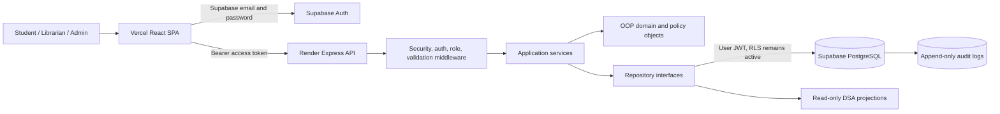
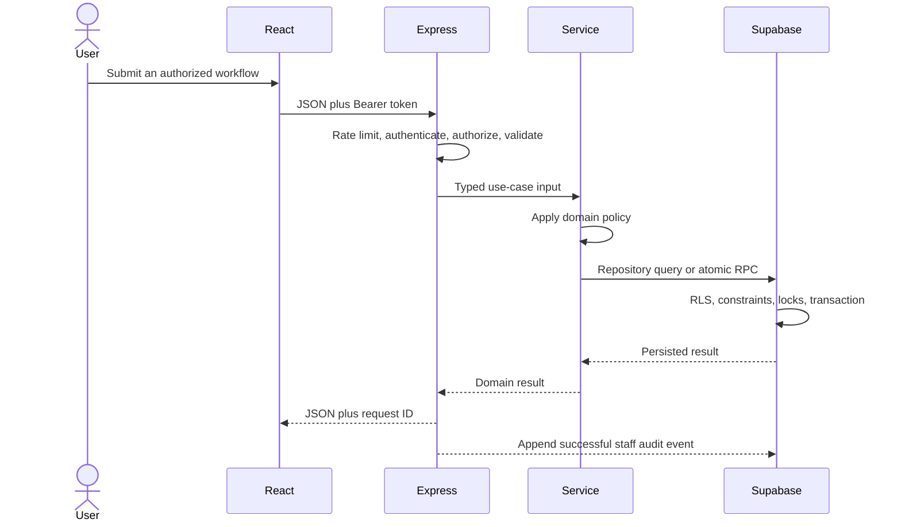
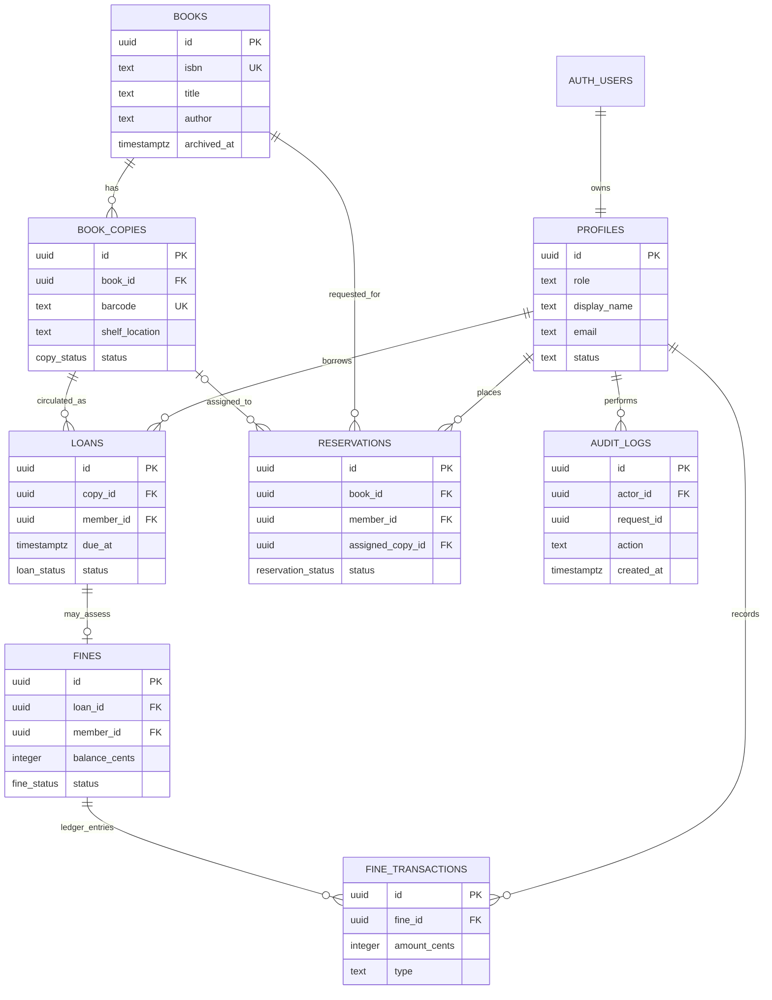
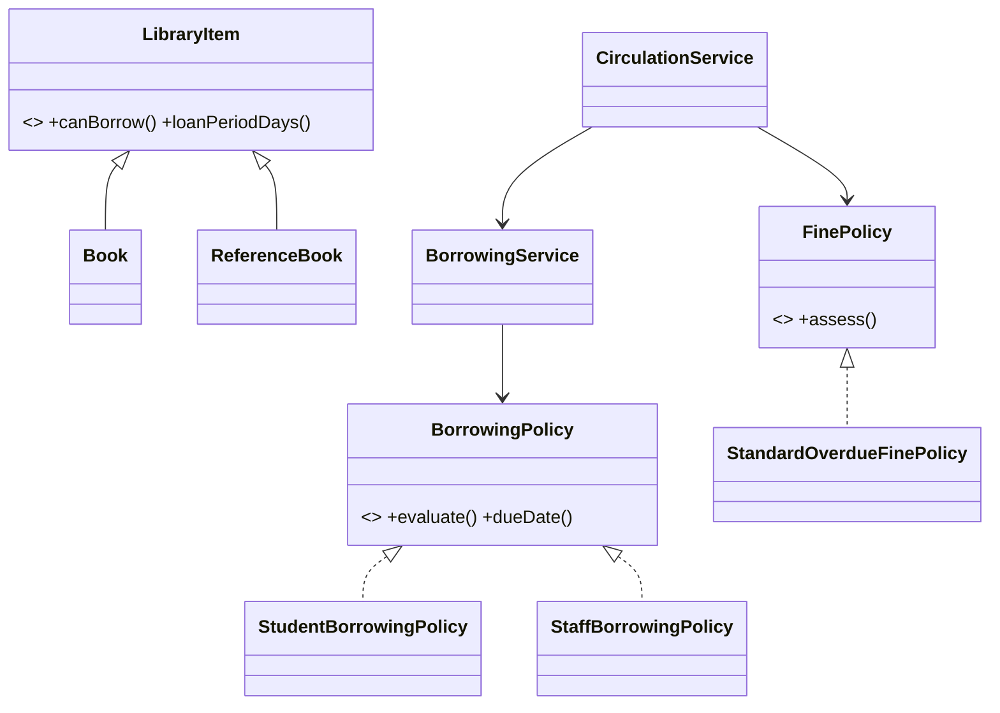
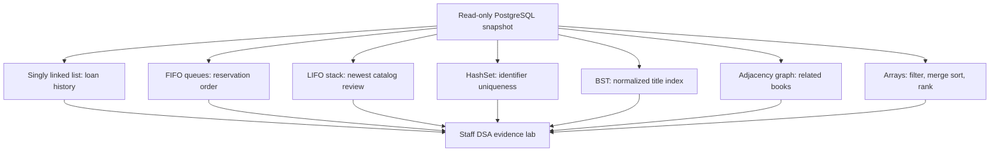

# Final system design

This is the submission architecture for the Smart Library Borrowing and Management System. It describes the implemented system at Milestone 10; it is not a future-state proposal.

## Deployment architecture

The browser has publishable credentials only. Express verifies Supabase identities and never trusts a role supplied by the browser. Each repository creates a Supabase client with the caller's JWT, so PostgreSQL RLS is still the final authorization boundary.

## Request flow

## Entity relationship diagram

## OOP evidence map

- Encapsulation: private state in `Member`, `Loan`, and `LibraryItem` changes through validated public methods.
- Abstraction: repository, borrowing-policy, and fine-policy interfaces separate stable contracts from implementations.
- Inheritance: `Book` and `ReferenceBook` are genuine specializations of `LibraryItem`.
- Polymorphism: `BorrowingService` and circulation code invoke policy contracts while subtype behavior determines eligibility and dates.

## DSA evidence map

PostgreSQL remains authoritative. The structures are rebuilt for education and visualization; production catalog reads continue through indexed database queries. Complexity details and algorithm tests are in `academic-evidence.md`, `dsa-milestone-8a.md`, and `dsa-milestone-8b.md`.
